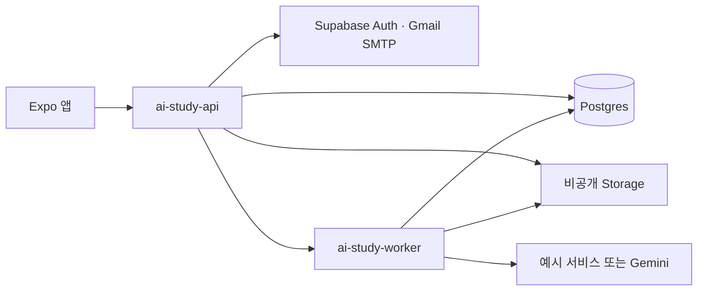

# Supabase 클라우드 API

## 구성



승인된 배포 대상은 `jqhivsrfrkycfjefgoam`의 Supabase Free입니다. Firebase `ai-study-97811`은 Spark 상태로 두며 API 실행에 사용하지 않습니다. 기존 Docker 이미지는 별도 배포 방식입니다. 카드 등록·유료 플랜·Cloud Run을 사용하지 않습니다.

API 주소:

```text
https://jqhivsrfrkycfjefgoam.supabase.co/functions/v1/ai-study-api/api/v1
```

## 앱에서 실행

프로젝트 루트에서 실행합니다. 추가 앱 패키지는 필요하지 않습니다. 개발 의존성이 없는 환경에서는 먼저 설치합니다.

```sh
pnpm install
pnpm --dir server install
```

클라우드 API가 준비된 뒤 다음 명령으로 앱을 시작합니다.

```sh
pnpm dev:cloud
```

`dev:cloud`는 `/health`에서 클라우드 DB 버전과 삭제 메일 설정을 확인하고 `.env`의 공개 API 주소를 갱신한 다음 Expo를 실행합니다. 다른 Expo가 실행 중이면 해당 터미널에서 먼저 종료합니다. `dev:email`·`dev:gemini`·`server:connect`는 로컬 서버로 전환하는 명령이므로 클라우드 실행에는 `dev:cloud`를 사용합니다.

클라우드로 처음 전환하면 로컬 서버에서 발급한 토큰은 사용할 수 없으므로 이메일로 다시 로그인합니다. 이후 클라우드 앱 세션은 7일 동안 유지되고 Secure Store에서 복원됩니다. 네트워크 오류는 로그인 만료로 취급하지 않습니다.

## 기존 API 계약

인증·자료 CRUD·등록 결과 확인·요약·문제 생성·작업 조회·풀이·학습 기록 API의 기존 경로와 응답을 유지합니다. `src/api`의 axios 인터셉터와 화면은 그대로 사용합니다. 파일 업로드는 기존과 같이 `multipart/form-data`이며, 클라이언트의 사진 압축·리사이징을 유지합니다.

- API 함수 내부에서 43자리 앱 토큰의 SHA-256 해시, 만료 시간, 사용자 소유권을 확인합니다.
- `/auth/login`, `/auth/verify`, `/health`만 로그인 전 접근할 수 있습니다.
- `study` 스키마는 Data API에 직접 노출하지 않고 모든 테이블에 RLS를 적용합니다. 공개 RPC 2개는 `service_role`만 실행할 수 있습니다.
- 작업 실행 함수는 게이트웨이 JWT 검증과 서버 키 검증을 모두 사용합니다. 앱 토큰·publishable 키로 작업 실행 함수를 호출할 수 없습니다.
- 일반 문제 조회와 생성 완료 응답에는 정답·해설이 없습니다. 제출 결과에서 해당 문제의 정답·해설을 전달합니다.
- 자료의 `isPublic` 값은 저장하되, 공유 탐색 API는 MVP 이후에 구현합니다. 현재는 자신의 자료만 조회합니다.

## DB와 사진

`migrations/`의 SQL을 번호 순서대로 적용합니다. SQL은 새 클라우드 구조를 생성하며 기존 로컬 SQLite와 사진을 복사하거나 삭제하지 않습니다. 기존 데이터 이전은 사용자 ID 매핑과 사진 업로드를 포함한 별도 작업입니다. 클라우드 첫 로그인 목록은 새 저장소의 자료만 표시합니다. 기기의 이전 계정 ID에 묶인 임시 저장본도 자동으로 다른 사용자 ID에 재배정하지 않습니다.

사진은 비공개 `ai-study-materials` 버킷에 저장합니다. 장당 5MB·최대 10장, JPEG·PNG·WebP 파일 내용과 MIME을 검사합니다. 생성 시 요청 키와 본문·사진 해시를 저장해 재전송을 재사용하고, 자료 삭제 후에도 등록 키의 삭제 상태를 보존합니다. 수정·삭제는 자료 revision을 확인합니다.

업로드 전에 DB에 예약을 만들고, 자료에 연결하지 못한 사진은 10분 후 정리 대상이 됩니다. 삭제한 사진도 DB의 정리 대기열에 보관합니다. 목록 조회·저장·삭제·작업 실행 시 정리를 재시도합니다. 외부 Storage 장애 때 파일의 물리 삭제는 지연될 수 있으며, 요청이 전혀 없는 기간에는 대기열이 다음 실행까지 남습니다. 직접 `storage.objects` 행을 삭제하지 않습니다. 사진 주소는 1시간 동안 유효한 서명 URL입니다.

## 비동기 AI 작업

생성 요청 → DB에 `QUEUED` 저장 → HTTP 202와 작업 ID 반환 → 별도 작업 실행 함수가 원자적으로 `PROCESSING` 선점 → 결과와 `COMPLETED`를 한 트랜잭션으로 저장합니다. 앱은 3초 간격으로 상태를 조회합니다. 실행 전달이 실패한 대기 작업은 다음 상태 조회 때 다시 전달합니다. 여러 전달이 있어도 DB에서 한 실행만 선점합니다.

요약과 같은 설정의 문제 묶음은 저장된 결과를 재사용합니다. 진행 중 작업을 중복 생성하지 않습니다. 실패 작업은 새 요청 키를 통한 명시적인 재시도로 시작합니다. AI 공급자 자동 재시도는 없습니다. 작업이 중단되면 135초의 실행 임대 만료 후 다음 조회에서 실패로 바뀝니다. 자료 수정·삭제는 생성·채점 중에 제한합니다.

Supabase Free의 실행 시간 제한을 고려해 생성 호출에는 105초 제한을 두었습니다. 긴 자료나 많은 문제로 초과하면 자료 분량·문제 수를 줄여야 합니다. 영구 작업 저장은 서버리스 실행 시간 제한을 없애지는 않습니다. 사용자별 하루 생성 30회, 동시 작업 3개, 풀이 500회를 제한합니다.

### 실제 Gemini 연결

기본값 `AI_PROVIDER=mock`은 실제 생성·OCR·의미 채점을 하지 않는 예시 서비스입니다. 키를 추가한 것만으로 실제 호출이 켜지지 않습니다. 실제 호출을 사용할 때만 Supabase **Edge Functions → Secrets**에서 다음 값을 설정합니다.

```dotenv
AI_PROVIDER=gemini
GEMINI_MODEL=gemini-3.5-flash-lite
GEMINI_API_KEY=<본인이 직접 입력하는 키>
```

모델 접근 권한과 Google AI Studio의 무료 사용 범위를 해당 계정에서 확인한 뒤 켭니다. 키는 앱·GitHub·대화에 넣지 않습니다. 클라우드 어댑터는 Gemini와 예시 서비스를 구현했습니다. 기존 로컬 서버의 OpenAI 어댑터는 유지되며, 클라우드 OpenAI 어댑터는 이번 이전 범위에 포함하지 않았습니다.

## 계정 삭제 인증

로그인 코드와 삭제 코드를 분리하기 위해 Auth의 **Reauthentication** 이메일 템플릿에 `email-templates/delete-account.html`을 설정합니다. 제목은 `AI Study 계정 삭제 인증 코드`입니다. `Reset password` 템플릿을 삭제용으로 사용하지 않습니다.

앱은 기존처럼 삭제 코드를 요청하고, 받은 6자리를 입력해 영구 삭제를 확정합니다. 서버는 현재 앱 세션의 사용자만 대상으로 내부 임시 Auth 세션을 만들고 `/reauthenticate`로 삭제 확인 메일을 보냅니다. 내부 `generate_link`는 메일을 발송하지 않으며 사용자 신규 생성을 하지 않는 recovery 유형을 사용합니다. 임시 토큰은 반환·저장·로그 출력하지 않고 요청 후 폐기합니다.

재인증 nonce는 로그인 코드와 다른 Auth 필드에 저장됩니다. 서버는 새 nonce의 해시를 삭제 요청에 묶어 5분·최대 5회로 확인하고 한 번 소비합니다. 실제 사용자 삭제는 관리 API를 통해 수행합니다. Auth 사용자 삭제의 FK cascade가 자료·요약·문제·기록·세션을 함께 지우고, 사진 정리 대기열은 남겨 재시도합니다.

이 구현은 Supabase Auth의 `reauthentication_token`, `reauthentication_sent_at` 및 SHA-224(email + nonce) 규약을 사용합니다. Supabase Auth 규약이 바뀌면 `functions/_shared/platform.ts`의 `nonceHash`와 두 번째 마이그레이션의 계정 RPC를 변경해야 합니다. 향후 비밀번호 변경 기능을 추가하면 재인증 템플릿과 nonce 용도를 함께 재설계합니다.

템플릿 저장 후에만 서버 설정 `ACCOUNT_DELETION_ENABLED=true`를 적용합니다.

## 수정 파일과 API 가정

| 변경할 사항 | 수정 위치 |
| --- | --- |
| HTTP 경로·요청·응답 | `functions/ai-study-api/index.ts`, `_shared/contracts.ts` |
| Supabase REST·Storage·Auth 연결 | `functions/_shared/platform.ts` |
| OTP·앱 세션·삭제 확인 | `functions/_shared/auth.ts`, `migrations/` |
| 자료 저장·이미지 검사 | `functions/_shared/materials.ts`, 첫 번째 SQL의 core RPC |
| 생성 프롬프트·모델·결과 검증 | `functions/_shared/ai.ts`, `ai-study-worker/index.ts` |
| 앱 접속 주소·준비 확인 | `scripts/connect-app.mjs`, `projects.json` |

서버 오류는 `{code,message}`, 성공은 기존처럼 응답 본문을 바로 반환합니다. 앱은 Supabase Auth JWT가 아닌 7일 앱 토큰을 저장하므로 Supabase Auth의 기본 JWT 만료 시간과 앱 만료 시간은 다릅니다. refresh token 갱신 API는 추가하지 않았습니다.

## 빌드와 재배포

```sh
pnpm cloud:typecheck
pnpm typecheck
pnpm cloud:bundle
```

`cloud:bundle`은 기존 서버의 고정된 esbuild를 사용해 대시보드 편집기에 붙여 넣을 단일 파일 2개를 `outputs/supabase-deploy/`에 만듭니다. Docker 설치는 필요하지 않습니다. 생성 파일은 직접 수정하지 않습니다. API 함수는 앱 세션 검증을 사용하도록 기본 legacy JWT 검증을 끄고, 작업 실행 함수는 켭니다. 이 인증 방식 전환은 사용자가 명시적으로 승인했습니다.

선택적으로 이후 CLI를 사용할 수 있습니다. CLI 로그인은 사용자가 직접 완료하며 인증 정보는 대화로 보내지 않습니다.

```sh
pnpm dlx supabase login
pnpm dlx supabase functions deploy ai-study-worker --project-ref jqhivsrfrkycfjefgoam --use-api
pnpm dlx supabase functions deploy ai-study-api --project-ref jqhivsrfrkycfjefgoam --use-api
```

이번 SQL 적용은 대시보드에서 수행하므로 향후 CLI로 DB 마이그레이션을 관리할 때는 이미 적용한 버전을 `migration repair --status applied`로 먼저 등록해야 합니다. 기존 프로젝트에 첫 SQL을 다시 실행하면 중복 생성 오류가 발생합니다. 파괴적인 reset 명령으로 해결하지 않습니다.

## 확인 범위

현재 배포 상태와 확인 범위는 `DEPLOYMENT_STATUS.md`에 기록합니다. TypeScript 검사·번들 생성·DB 적용·함수 배포 성공은 실제 앱 로그인·사진 업로드·메일 수신·AI 응답 전체 흐름을 통과했다는 뜻이 아닙니다. 새 이메일 발송·AI 호출·영구 삭제 검사는 사용자 요청을 받은 뒤 진행합니다.

## 공식 근거

- [Edge Functions background tasks](https://supabase.com/docs/guides/functions/background-tasks)
- [Edge Functions limits](https://supabase.com/docs/guides/functions/limits)
- [서버 환경 변수](https://supabase.com/docs/guides/functions/secrets)
- [CLI의 Docker 없는 배포](https://supabase.com/docs/reference/cli/supabase-functions-deploy)
- [재인증 코드 발송](https://supabase.com/docs/reference/javascript/auth-reauthenticate)
- [Auth 재인증 구현](https://github.com/supabase/auth/blob/master/internal/api/reauthenticate.go)
- [Auth 코드 해시 구현](https://github.com/supabase/auth/blob/master/internal/crypto/crypto.go)
